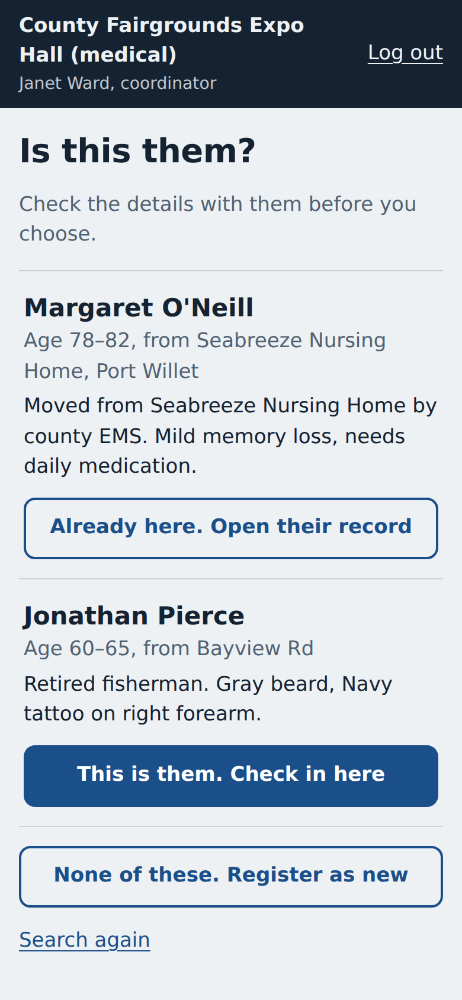
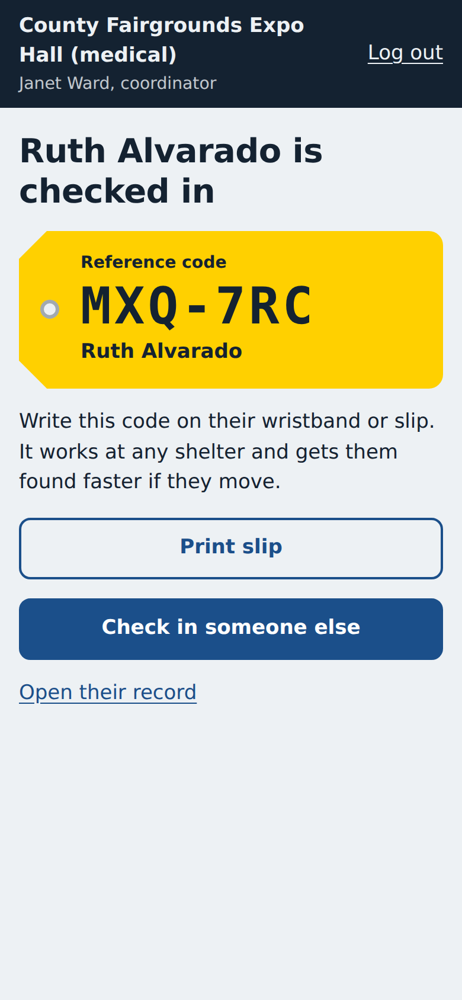
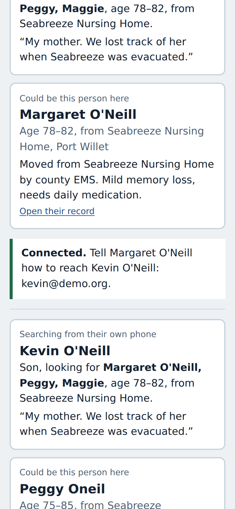
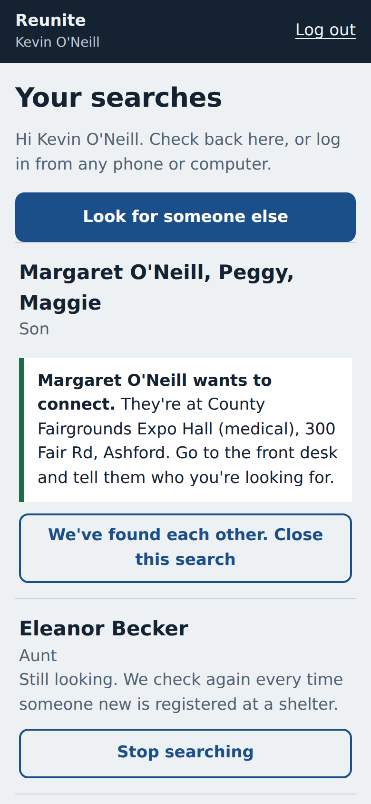
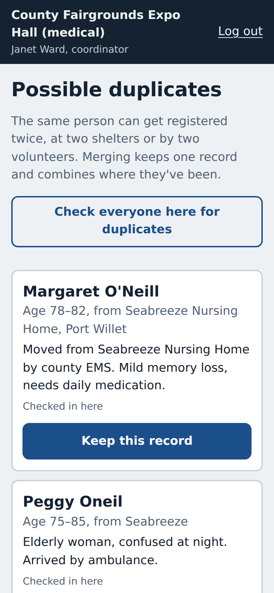

# Reunite

A shared check-in and reunification system for hurricane shelters. Volunteers register people at intake, records follow people between shelters, duplicates get caught and merged, and family members (or a volunteer on behalf of someone with no phone) can search every shelter at once. Nothing about a person is shared until that person says yes.

**Live:** https://reunite-web-b14e.onrender.com  
The API is on Render's free tier. The first load shows "Starting up" for up to a minute while it wakes.

**Try it:** every account uses the password `demo1234`.

| Role | Login |
|---|---|
| Volunteer | `fairgrounds.vol1@demo.org`, which already has a match and a duplicate waiting |
| Coordinator | `lincoln.authority@demo.org` |
| Family member | `kevin@demo.org` (under "I'm looking for someone") |

[SEED_SCENARIOS.md](SEED_SCENARIOS.md) walks through the planted cases: a woman registered twice under different names, a husband searched for by a wife with no phone, an abuser searching for someone who asked not to be found, and a child bused from school.

<p>





</p>

## The full picture

The people hardest to find are the ones without phones: the kid on the school bus, the nursing home resident moved by another agency, the person whose phone died. They can only be found through shelter records. So I built the system those records live in, and the search on top of it.

### Built

- **Intake.** The volunteer looks the person up before registering them. If they're already registered at another shelter, one tap checks them in here. Otherwise they're registered with whatever information they can give (only a name is required, and "Unknown" counts). Each person gets a reference code on a printable slip that works at any shelter.
- **Shelter chain.** Each person carries their full history of stays. A transfer closes the old stay and opens a new one, and checking out records that they left for family, a hotel or a hospital.
- **Duplicates.** Every registration is checked against everyone in the system, and a volunteer can scan their whole shelter. Merging two records combines their histories, resolves overlapping stays, and repoints any searches and matches.
- **Search.** A family member lists every name the person might go by, plus age, home area and a description. A volunteer can file the same search for someone with no phone. Searches run against everyone now, and against each new registration as it happens.
- **Consent.** A likely match goes to a volunteer at that person's shelter, who asks them. If they say yes, both sides get each other's details. Minors also need a coordinator's approval. If they say no, the searcher sees "still looking", identical to no match at all.
- **Accounts.** Coordinators create and deactivate volunteers at their own shelter. Public accounts can only search.

### Designed, not built

- **Paper backlog import.** A volunteer photographs a clipboard sheet, Azure Document Intelligence (free tier, handwriting plus table detection) turns each row into a draft record, and nothing is saved until a volunteer reviews it. This is meant as a one-time catch-up. After that, the app is faster than paper.
- **Photos.** Optional, kept in private storage, and shown only to confirm a match. Never searchable.
- **Notifications.** SMS or email when a search finds someone. People without phones keep getting updates through their shelter.
- **Agency bulk import.** A CSV upload for nursing homes, schools and hospitals that moved people in groups.
- **Offline intake.** Queue registrations on the device and sync when the connection comes back.

## Design

**Users.** The main user is the shelter volunteer: not technical, exhausted, with a line of people waiting. Coordinators vet volunteers and sign off on minors. Searchers have a device and want to say who they're looking for once. The people being searched for decide what happens next, and some of them are hiding.

**The 2 a.m. test.**

- One task per screen, and lookup always comes before registration.
- Ages are a range ("about 70" becomes 65–75), and blank is fine.
- Touch targets are at least 52px. The interface uses one typeface, Atkinson Hyperlegible, chosen for low-vision legibility and characters that are hard to mix up, so codes like `K7P-QX4` survive being read aloud.
- Dark mode for dim gyms. Sessions end when the tab closes, because desk devices are shared.

**Edge cases:**

| Case | Handling |
|---|---|
| No phone | Reference code slip. A volunteer files searches for them, and results show on their record. |
| No ID, alias, or first name only | Nothing requires ID, and matching tolerates partial names. |
| Doesn't want to be found | A private flag. Their matches are declined automatically and no one is ever asked. They're hidden from other shelters' lookups, but their code still works for transfers. |
| Abuser searching | Consent plus masking: a "no" or a private flag looks exactly like an empty search. |
| Unaccompanied minor | Flagged automatically when their age range is under 18. A coordinator must approve before anything is shared. |
| Moved between shelters | Transfer by lookup or by code. Pending matches follow the person to the new shelter's queue. |
| Registered twice | Flagged on intake and on scan. Merging is reviewed by a person, and if either record was private, the merged one stays private. |
| Same name, different person | A large age gap counts heavily against a match. The two Michael Johnsons in the demo data never collide. |
| Typos, nicknames, accents, name order | "Raj Sha" matches "Rajesh Shah", "Peggy" matches "Margaret", and "José Hernández" matches "JOSE HERNANDEZ". |
| Fishing for many people | Public users can have at most 10 open searches, and each search creates at most 5 candidate matches. |
| Bad volunteer account | Only coordinators create accounts, and deactivation takes effect on the next request. Lookups never reveal which shelter someone is at, every lookup and decision is audit-logged, and logins are rate-limited. |

**Assumptions:** coordinators are provisioned by county emergency management. Any volunteer can check in a person standing in front of them. Shelter names and addresses are public during an evacuation. Descriptions are visible to other shelters during matching, and the form says so.

## Technical choices

**Stack.** React 19, Vite and React Router on a Render static site. Node, Express and `pg` on a Render web service. PostgreSQL on Supabase. Auth is bcrypt plus JWTs, with separate tables and token types for staff and the public, so a public token can't pass a staff check.

**No third-party AI in matching.** These are names and locations of displaced people, some of them hiding. Matching runs in `server/src/lib/names.js`:

- NYSIIS phonetic keys, for names that sound alike.
- Jaro-Winkler similarity, for typos.
- A local nickname table, and order-insensitive comparison of name parts.
- Age-range gap and home area.

These combine into a 0–100 score. Postgres pre-filters the candidates with indexed phonetic and nickname keys plus `pg_trgm` trigram similarity, so only a few hundred rows are ever scored, not 400,000. The same scorer drives lookup (45+), search matches (60+) and duplicate flags (75+). `npm test` checks every pair of seeded people, and every seeded search lands on exactly the right person.

**Hosting.** The frontend is a static site so it never sleeps and can show the wake-up screen while the API cold-starts. The database is on Supabase because Render's free Postgres expires after 30 days. Row level security is on with no policies, which closes Supabase's auto-generated REST API; only the server, as table owner, can read the data.

**How it changed along the way:**

- **Phone-first became volunteer-first.** The first plan centered on people searching from their own phones, which misses the people most likely to be separated.
- **Photos moved off the critical path.** Photo search lets anyone find anyone.
- **Matching moved out of Postgres.** Double Metaphone in Postgres became NYSIIS in JavaScript, so it could be unit-tested and shared by every code path.
- **No Gemini for the paper import.** Its free tier uses submitted data to improve Google's products. Azure documents deletion within 24 hours.
- **No separate stays table.** Shelter history became a JSONB array on the person: one row tells one person's whole story, and a transfer is one update. The cost is that cross-stay reporting queries are harder.
- **Netlify became Render.** Both halves now deploy from one Blueprint.

**Biggest tradeoff: every match waits for a human.** Showing matches straight to searchers would reunite people faster and spare volunteer time, the scarcest resource in this scenario. I chose consent anyway. Sending an abuser to the right shelter, or a child to the wrong adult, is worse than a few hours of delay.

The second tradeoff is that the paper import, unlike matching, would send images to a cloud service. I'd accept that for a one-time import a volunteer starts deliberately, but not for every search.

## Running locally

```bash
cd server && cp .env.example .env    # DATABASE_URL, JWT_SECRET
npm install && npm run db:reset -- --yes && npm test && npm run dev
cd ../client && npm install && npm run dev    # http://localhost:5173
```

## Working with AI

I used Claude as a pair programmer. I made the product calls: volunteers first, no third-party AI on names, separate staff and public tables, a single name per person, history stored on the person, coordinators gating access, and paper import as a one-time catch-up. Claude wrote most of the code to that spec, and I reviewed and tested it against the scenarios above.

The most useful habit was making it check instead of assume. Checking current docs ruled out Gemini's free tier and Render's Postgres. Headless browser screenshots caught a page stuck in a reload loop. And when I pasted a database secret into the public `render.yaml`, it was flagged, and I rotated the password.
